# Práctica de VHDL

**Espínola Maximiliano Ariel**

**SIU: e2603**

**Circuitos Lógicos Programables — Especialización en Sistemas Embebidos**

Resolución de la *Guía de VHDL*: 18 circuitos digitales descriptos en VHDL, cada uno verificado mediante un banco de pruebas (testbench) también escrito en VHDL. Cada carpeta contiene el diseño, su testbench y una captura de la simulación.

## Resumen de ejercicios

| N° | Ejercicio | Estilo | Estado |
|:--:|-----------|--------|:------:|
| 01 | [Sumador completo de 1 bit](#01-sumador-completo) | — | ✅ |
| 02 | [Sumador de 4 bits](#02-sumador4-estructural) | Estructural | ✅ |
| 03 | [Sumador/restador de 4 bits con señal de control de operación](#03-sumador-restador4) | Estructural | ✅ |
| 04 | [Multiplexor 2x1](#04-mux2to1) | — | ✅ |
| 05 | [Flip-flop D con flanco ascendente, reset sincrónico y habilitación](#05-dff-en-srst) | — | ✅ |
| 06 | [Registro de desplazamiento de 4 bits a derecha (entrada y salida serie) usando el FF del ejercicio 5](#06-reg-desp4-estructural) | Estructural | ✅ |
| 07 | [Registro de desplazamiento de 4 bits a derecha, descripto por comportamiento](#07-reg-desp4-comportamiento) | Comportamiento | ✅ |
| 08 | [Barrel shifter de N bits (genérico)](#08-barrel-shifter-comportamiento) | Comportamiento | ✅ |
| 09 | [Barrel shifter implementado con multiplexores 2x1 (ancho fijo)](#09-barrel-shifter-muxes) | Estructural (multiplexores 2x1) | ✅ |
| 10 | [Contador binario de 4 bits](#10-contador4-estructural) | Estructural | ✅ |
| 11 | [Contador binario de 4 bits](#11-contador4-comportamiento) | Comportamiento | ✅ |
| 12 | [Contador binario genérico de N bits](#12-contadorn-estructural) | Estructural | ✅ |
| 13 | [Contador binario genérico de N bits](#13-contadorn-comportamiento) | Comportamiento | ✅ |
| 14 | [Contador BCD de 1 dígito: registro de 4 bits con reset sincrónico, incrementador y comparador (=9)](#14-contador-bcd-estructural) | Estructural | ✅ |
| 15 | [Contador BCD de 1 dígito](#15-contador-bcd-comportamiento) | Comportamiento (process) | ✅ |
| 16 | [Contador BCD de 4 dígitos (0000–9999) con entrada de habilitación y carry out](#16-contador-bcd4digitos) | Comportamiento (process) | ✅ |
| 17 | [Generador de habilitación: pulso de 1 ciclo de reloj cada N ciclos](#17-generador-habilitacion) | — | ✅ |
| 18 | [Contador BCD de 1 dígito que avanza cada 1 s (generador de habilitación + habilitación general), salida en 4 LEDs](#18-contador-bcd-1seg-top) | Top-level | ✅ |

> Todos los ejercicios están resueltos y simulados.

## Estructura del repositorio

```text
.
├── README.md
├── 01_sumador_completo/
├── 02_sumador4_estructural/
├── 03_sumador_restador4/
├── 04_mux2to1/
├── 05_dff_en_srst/
├── 06_reg_desp4_estructural/
├── 07_reg_desp4_comportamiento/
├── 08_barrel_shifter_comportamiento/
├── 09_barrel_shifter_muxes/
├── 10_contador4_estructural/
├── 11_contador4_comportamiento/
├── 12_contadorN_estructural/
├── 13_contadorN_comportamiento/
├── 14_contador_bcd_estructural/
├── 15_contador_bcd_comportamiento/
├── 16_contador_bcd4digitos/
├── 17_generador_habilitacion/
└── 18_contador_bcd_1seg_top/
```

Dentro de cada carpeta: archivos `.vhd` del diseño, testbench `_tb.vhd` y la captura `NN_nombre_simulacion.png`.

---

## 01-sumador-completo

**Sumador completo de 1 bit.**

- **Estilo:** —
- **Carpeta:** [`01_sumador_completo/`](01_sumador_completo/)

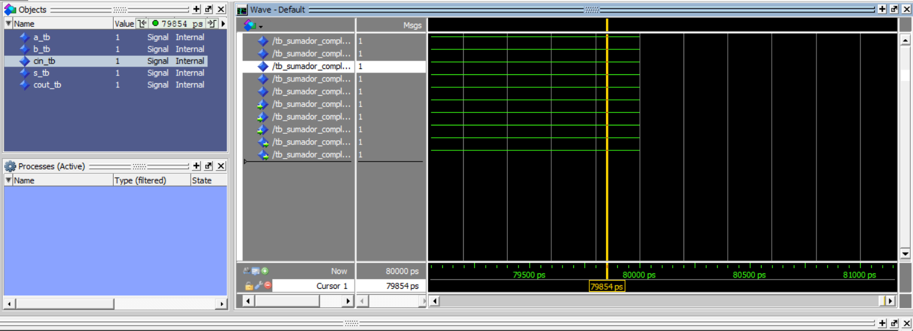

## 02-sumador4-estructural

**Sumador de 4 bits.**

- **Estilo:** Estructural
- **Carpeta:** [`02_sumador4_estructural/`](02_sumador4_estructural/)

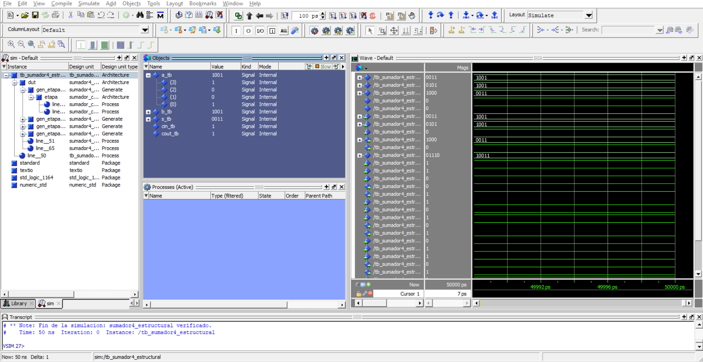

## 03-sumador-restador4

**Sumador/restador de 4 bits con señal de control de operación.**

- **Estilo:** Estructural
- **Carpeta:** [`03_sumador_restador4/`](03_sumador_restador4/)

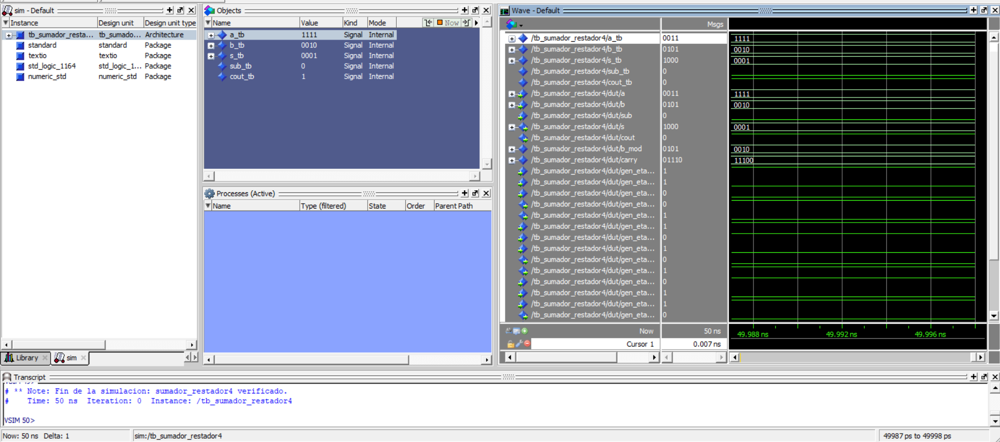

## 04-mux2to1

**Multiplexor 2x1.**

- **Estilo:** Comportamiento
- **Carpeta:** [`04_mux2to1/`](04_mux2to1/)

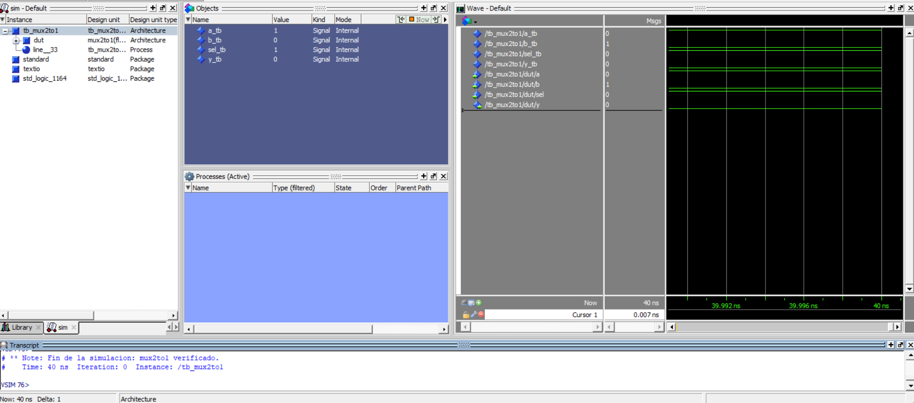

## 05-dff-en-srst

**Flip-flop D con flanco ascendente, reset sincrónico y habilitación.**

- **Estilo:** Comportamiento
- **Carpeta:** [`05_dff_en_srst/`](05_dff_en_srst/)


## 06-reg-desp4-estructural

**Registro de desplazamiento de 4 bits a derecha (entrada y salida serie) usando el FF del ejercicio 5.**

- **Estilo:** Estructural
- **Carpeta:** [`06_reg_desp4_estructural/`](06_reg_desp4_estructural/)

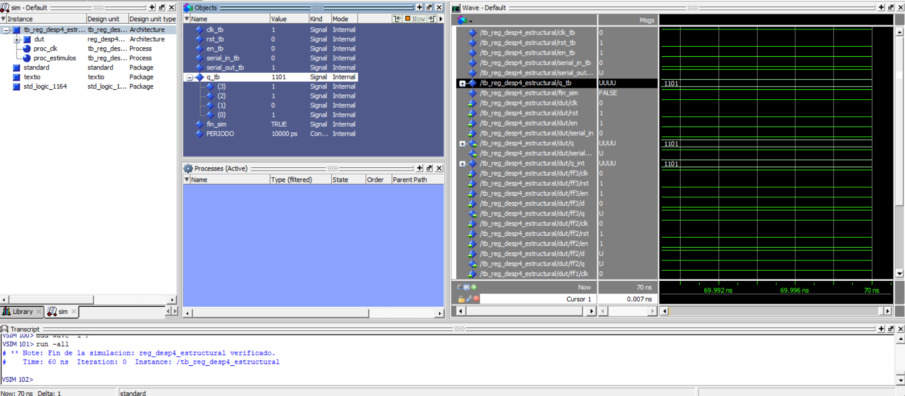

## 07-reg-desp4-comportamiento

**Registro de desplazamiento de 4 bits a derecha, descripto por comportamiento.**

- **Estilo:** Comportamiento
- **Carpeta:** [`07_reg_desp4_comportamiento/`](07_reg_desp4_comportamiento/)

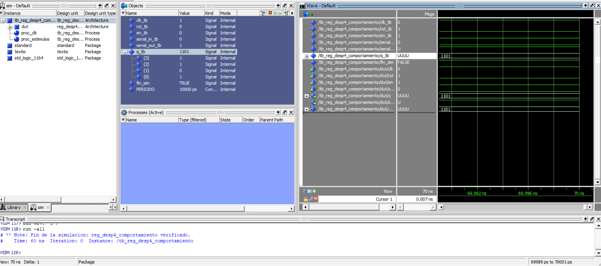

## 08-barrel-shifter-comportamiento

**Barrel shifter de N bits (genérico).**

- **Estilo:** Comportamiento
- **Carpeta:** [`08_barrel_shifter_comportamiento/`](08_barrel_shifter_comportamiento/)

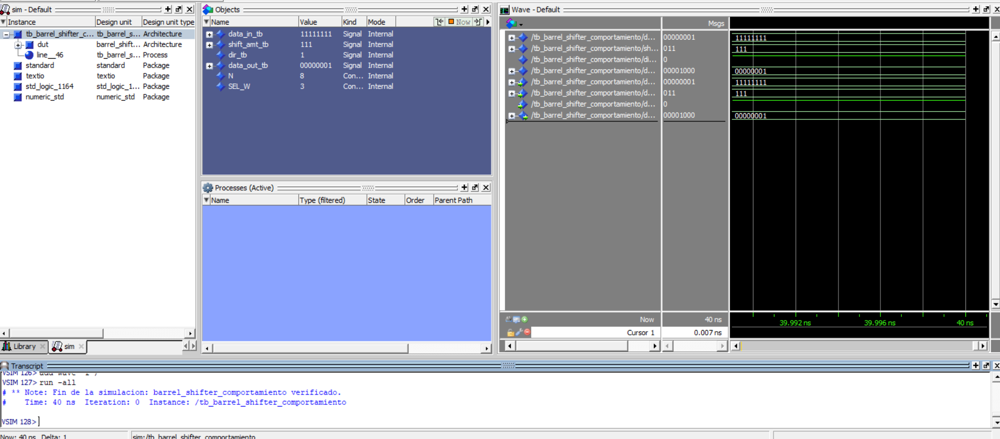

## 09-barrel-shifter-muxes

**Barrel shifter implementado con multiplexores 2x1 (ancho fijo).**

- **Estilo:** Estructural (multiplexores 2x1)
- **Carpeta:** [`09_barrel_shifter_muxes/`](09_barrel_shifter_muxes/)

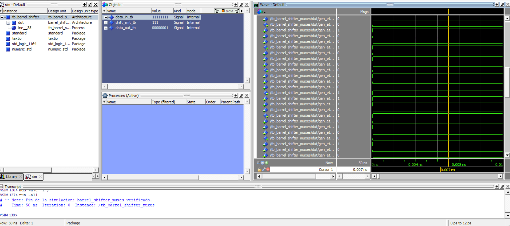

## 10-contador4-estructural

**Contador binario de 4 bits.**

- **Estilo:** Estructural
- **Carpeta:** [`10_contador4_estructural/`](10_contador4_estructural/)

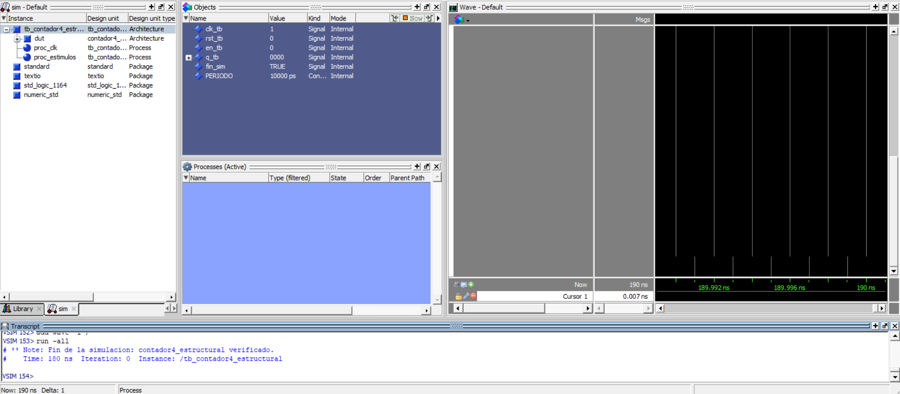

## 11-contador4-comportamiento

**Contador binario de 4 bits.**

- **Estilo:** Comportamiento
- **Carpeta:** [`11_contador4_comportamiento/`](11_contador4_comportamiento/)

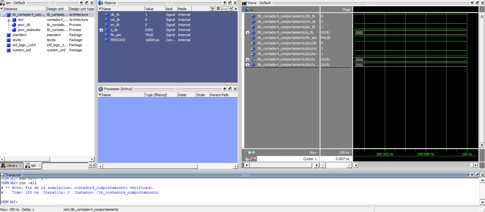

## 12-contadorN-estructural

**Contador binario genérico de N bits.**

- **Estilo:** Estructural
- **Carpeta:** [`12_contadorN_estructural/`](12_contadorN_estructural/)

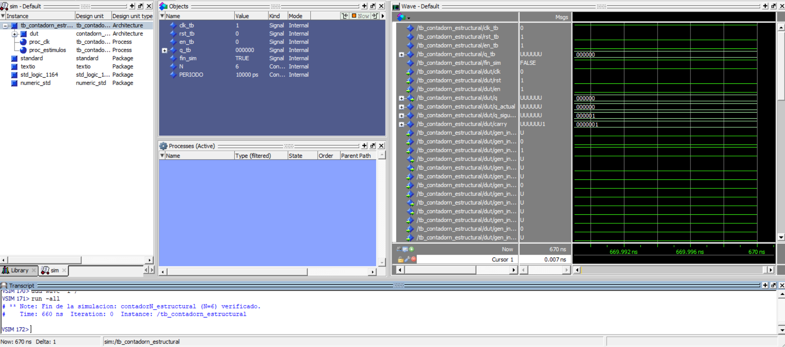

## 13-contadorN-comportamiento

**Contador binario genérico de N bits.**

- **Estilo:** Comportamiento
- **Carpeta:** [`13_contadorN_comportamiento/`](13_contadorN_comportamiento/)


## 14-contador-bcd-estructural

**Contador BCD de 1 dígito: registro de 4 bits con reset sincrónico, incrementador y comparador (=9).**

- **Estilo:** Estructural
- **Carpeta:** [`14_contador_bcd_estructural/`](14_contador_bcd_estructural/)


## 15-contador-bcd-comportamiento

**Contador BCD de 1 dígito.**

- **Estilo:** Comportamiento (process)
- **Carpeta:** [`15_contador_bcd_comportamiento/`](15_contador_bcd_comportamiento/)

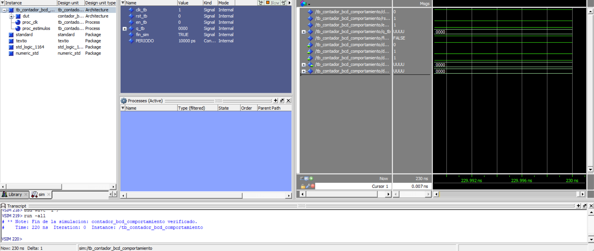

## 16-contador-bcd4digitos

**Contador BCD de 4 dígitos (0000–9999) con entrada de habilitación y carry out.**

- **Estilo:** Comportamiento (process)
- **Carpeta:** [`16_contador_bcd4digitos/`](16_contador_bcd4digitos/)

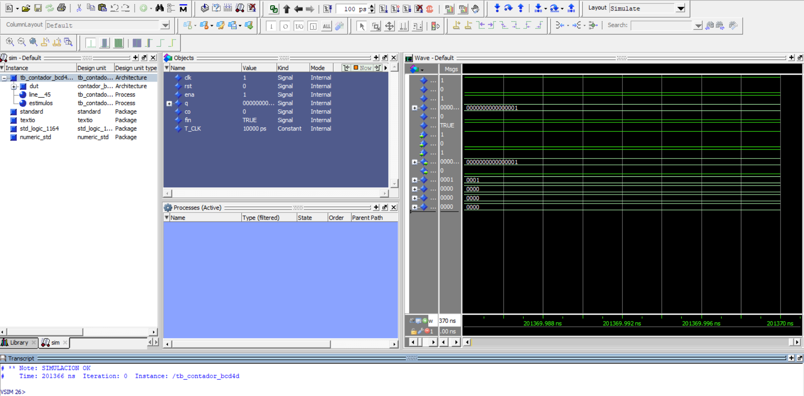

## 17-generador-habilitacion

**Generador de habilitación: pulso de 1 ciclo de reloj cada N ciclos.**

- **Estilo:** Comportamiento
- **Carpeta:** [`17_generador_habilitacion/`](17_generador_habilitacion/)

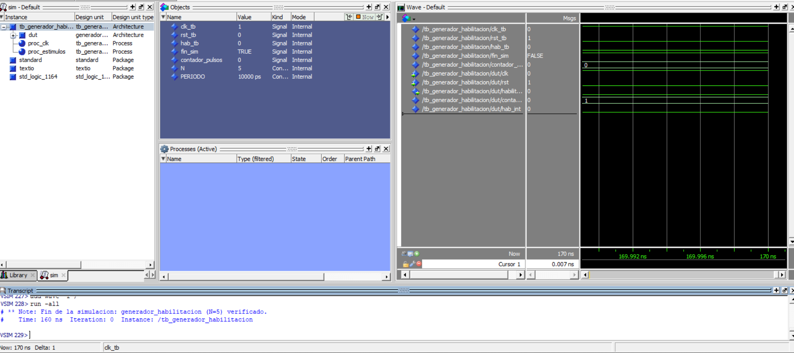

## 18-contador-bcd-1seg-top

**Contador BCD de 1 dígito que avanza cada 1 s (generador de habilitación + habilitación general), salida en 4 LEDs.**

- **Estilo:** Top-level
- **Carpeta:** [`18_contador_bcd_1seg_top/`](18_contador_bcd_1seg_top/)

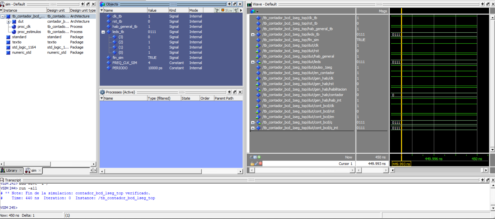
